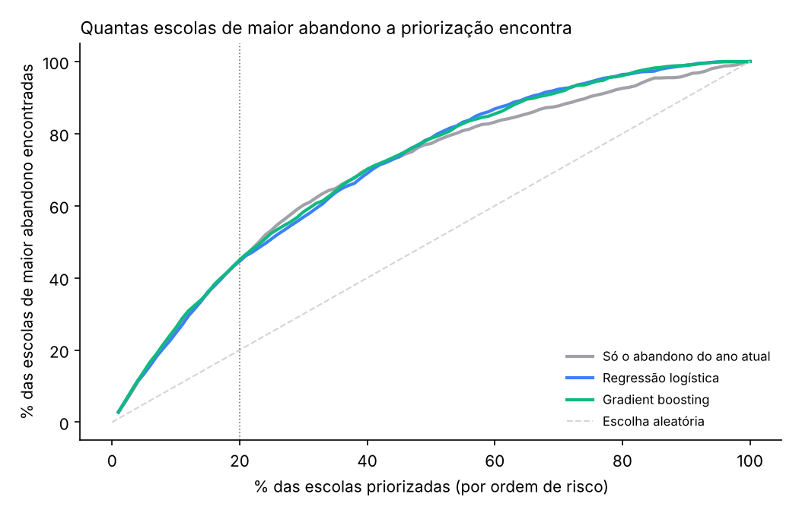
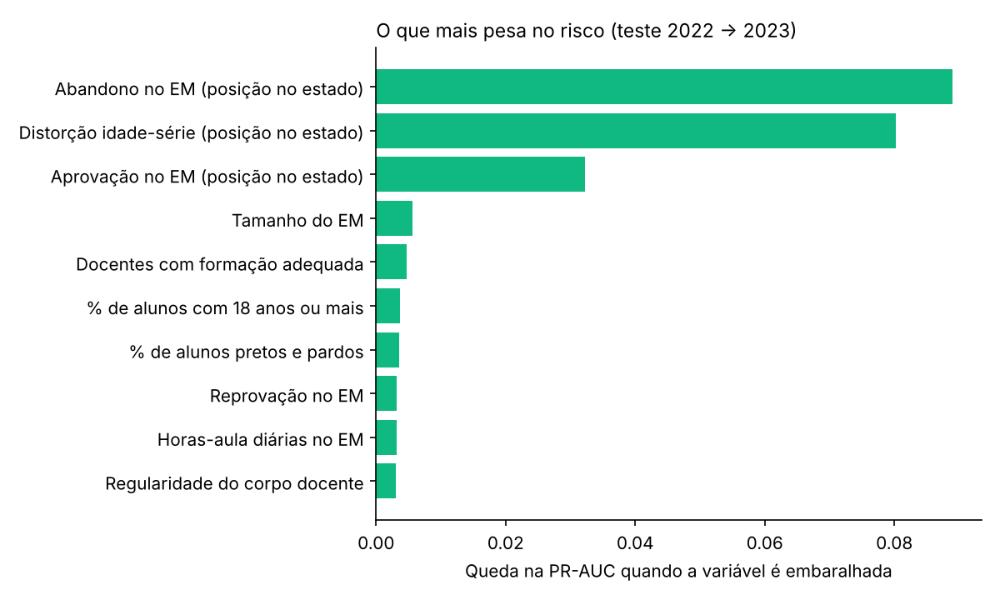

# Risco de abandono no ensino médio — escolas estaduais do Nordeste

[](https://github.com/Diogo-Nobrega7/risco-evasao-ept/actions/workflows/testes.yml)

Dá para prever, com dados públicos, quais escolas vão ter o maior abandono no ensino médio no ano seguinte?
E um modelo de machine learning faz isso melhor que uma regra simples?

**Resposta curta:** a posição da escola no abandono *deste* ano já carrega quase todo o sinal. O modelo ordena
um pouco melhor no Nordeste, mas, para escolher as 20% escolas a priorizar, empata com a regra simples. No RN,
não há evidência de ganho. Para a gestão, a recomendação é usar a regra simples, que é transparente e
fácil de explicar, e acompanhar a distorção idade-série como segundo sinal.



## Pergunta e recorte

- **Unidade:** escola. Desde 2022 o INEP não publica dados por aluno (LGPD), então o risco é da escola, não do estudante.
- **Escolas:** estaduais do Nordeste, em funcionamento, com pelo menos 30 matrículas no ensino médio.
  São 4.819 escolas no treino e 4.849 no teste (cerca de 300 no RN).
- **Alvo:** a escola estar entre as **25% de maior abandono no ensino médio do seu estado, no ano seguinte**.
- **Validação temporal:** treino com 2021 → 2022, teste com 2022 → 2023. O futuro nunca entra no treino.

### Por que um alvo relativo ao estado

O primeiro desenho usava um limiar fixo (abandono ≥ 10%). Não funcionou bem por dois motivos:

| | Escolas com abandono ≥ 10% no ano seguinte |
|---|---|
| Treino (2021 → 2022) | 30,2% |
| Teste (2022 → 2023) | 10,8% |

O patamar caiu muito depois da pandemia e varia entre estados (mediana de 8,3% no RN contra 0% em PE em 2023).
Um limiar fixo mistura essas mudanças de nível com o risco da escola. O alvo relativo responde à pergunta que a
gestão de fato faz: *quais escolas da minha rede priorizar?*

## Resultados (teste 2022 → 2023)

Métrica principal: **captura no top 20%**, ou seja, das escolas que de fato ficaram no quartil de maior abandono,
quantas estão entre as 20% de maior risco segundo cada método.

| Método | Recorte | ROC-AUC | PR-AUC | Captura no top 20% |
|---|---|---|---|---|
| Só o abandono do ano atual (posição no estado) | Nordeste | 0,754 | 0,521 | 44,9% |
| Regressão logística | Nordeste | 0,769 | 0,521 | 44,6% |
| Gradient boosting | Nordeste | **0,772** | **0,536** | 45,0% |
| Só o abandono do ano atual | RN (308 escolas) | 0,848 | **0,682** | **56,4%** |
| Regressão logística | RN | **0,860** | 0,639 | 53,8% |
| Gradient boosting | RN | 0,855 | 0,641 | 51,3% |

Taxa base: 25,3% das escolas estão no alvo. Escolher ao acaso capturaria 20%.

**A diferença é real?** Bootstrap por escola (1.000 reamostragens), gradient boosting menos a regra simples:

| Recorte | ROC-AUC | PR-AUC | Captura no top 20% |
|---|---|---|---|
| Nordeste | +0,017 (IC95% +0,004 a +0,032) | +0,015 (−0,001 a +0,032) | +0,1 p.p. (−1,6 a +1,8) |
| RN | +0,008 (−0,042 a +0,063) | −0,038 (−0,116 a +0,043) | −5,7 p.p. (−14,1 a +1,4) |

Só o ganho de ROC-AUC no Nordeste é estatisticamente claro, e ele é pequeno.

### O que mais pesa



Importância por permutação no conjunto de teste. Abandono, distorção idade-série e aprovação, todos medidos como
posição da escola no estado, dominam. Infraestrutura, tempo integral e oferta técnica quase não mudam a previsão
depois que essas três entram.

## Limitações

- Dois pares de anos, logo após a pandemia: o padrão pode mudar.
- Sem dados por aluno; o modelo não identifica estudantes, só escolas.
- Faltou o nível socioeconômico (INSE) por escola: o arquivo não estava disponível no endereço esperado do INEP.
- Associação não é causa: a importância das variáveis mostra o que ajuda a prever, não o que provoca o abandono.

## Uso responsável

O repositório não publica ranking de escolas com nome. Rotular uma escola pública como "de risco" a partir de um
modelo pode virar estigma. O arquivo `relatorio/rn_risco_por_municipio.csv` traz só a média por município.

## Como rodar

```bash
python -m venv .venv && source .venv/bin/activate
pip install -r requirements.txt
python -m src.coleta      # baixa ~650 MB do INEP para data/raw/
python -m src.preparar    # monta data/processed/base_escolas.parquet
python -m src.modelo      # treina, avalia e gera relatorio/
python -m src.incerteza   # intervalos de confiança por bootstrap
pytest -q
```

O servidor do INEP não envia o certificado intermediário da RNP. Em vez de desligar a verificação TLS, o script
soma o intermediário oficial (`certs/rnp-icpedu-gr46.pem`, emitido pela GlobalSign) às CAs confiáveis.

## Estrutura

```
src/coleta.py      download dos dados do INEP (Censo Escolar e indicadores por escola)
src/preparar.py    junta Censo (ano t) + indicadores (ano t) + abandono (ano t+1)
src/modelo.py      alvo relativo, modelos, métricas, gráficos
src/incerteza.py   bootstrap das diferenças entre modelo e regra simples
tests/             testes do alvo e da métrica de captura
relatorio/         métricas, gráficos e resultado agregado do RN
```

## Próximos passos

- Incluir mais anos (2023 → 2024) quando os indicadores saírem, para checar se o resultado se mantém.
- Adicionar o INSE por escola.
- Testar o alvo em nível de turma ou série, onde o abandono se concentra (1ª série).

Dados: INEP — Microdados do Censo Escolar e Indicadores Educacionais (taxas de rendimento, TDI, ATU, HAD, AFD, IRD).
